# Can Kronos trade profitably? A pre-registered backtest study

**Study period:** 26–28 October 2026 · **Model:** Kronos-small (`NeoQuasar/Kronos-small`, pinned
revision `901c26c`) · **Repository:** `cntarun/autotrader` (fork of `shiyu-coder/Kronos`)

> **Disclaimer.** This is a technical research report, not financial, investment, tax or legal
> advice. Past performance in a backtest does not predict future returns.

---

## 1. Summary

We tested whether Kronos, an open-source foundation model that forecasts price candles, can
drive a profitable, low-maintenance trading system starting from €20. We ran five experiments
on real market data and fixed every pass/fail rule before seeing the results.

**Answer: no.** In every setup we tested, Kronos did not produce an edge that survives
realistic trading costs.

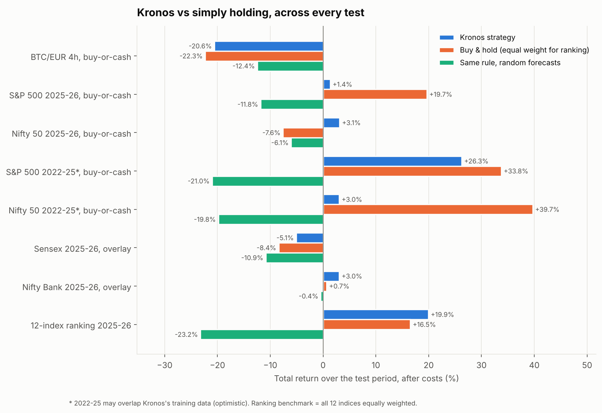

| # | Experiment | Data | Verdict |
|---|---|---|---|
| 1 | Buy-or-cash on Bitcoin | BTC/EUR, 4-hour candles, Sep 2025 – Oct 2026 | **Fail:** no forecasting skill; lost money at every fee level and did worse than random forecasts |
| 2 | Buy-or-cash on stock indices | S&P 500 and Nifty 50, daily, 2022 – 2026 | **Not usable:** holding the index returned more in 3 of 4 windows |
| 3 | "Stay invested, cut when bearish" overlay | Sensex and Nifty Bank, daily, Sep 2025 – Oct 2026 | **Fail:** small advantage disappears at 0.25% fees |
| 4 | Weekly ranking of 12 global indices | 12 indices, weekly, 2022 – 2026 | **Fail:** beat equal weight by too little (IR 0.27 vs 0.5 required), and not through forecasting skill |
| 5 | Kronos fine-tuned on index history | 12 indices to 2024; tested on Nifty 50 and S&P 500 | **Fail:** better fit to the data, but not better forecasts |

**Main findings**

1. **No signal on Bitcoin.** Up/down calls were right 49.5% of the time (a coin flip), and the
   confident calls were right only 45% of the time.
2. **A weak, real ranking signal on stock indices.** The rank correlation between forecast and
   outcome was positive in every index test (+0.06 to +0.18). Strongly positive forecasts were
   right about two-thirds of the time in 3 of the 4 index windows where there were enough of them.
3. **The forecasts lean bearish and are overconfident.** Kronos often predicted falls after
   rises, so strategies that only buy on a predicted rise sat in cash through bull markets. Real
   moves were up to about 1.9× wider than its forecast range.
4. **The edge is too small for real-world frictions.** Every advantage disappeared at modestly
   higher fees, after a one-period delay, or against simply holding the index.
5. **Fine-tuning improved the fit but not the forecasts.** Validation loss fell 15%, and the
   probabilities became better calibrated, but ranking skill fell on the S&P 500.

---

## 2. Background

**Kronos** is a family of decoder-only transformers pre-trained on candlestick (OHLCV) data from
45+ exchanges (AAAI 2026). A tokenizer turns each candle into discrete tokens, and the model
predicts future candles autoregressively. It **only forecasts prices**: it has no trading,
risk or execution logic.

**What we built** (`autotrader/` in this repository):

- A **probabilistic forecaster**: 16 independent sample paths per decision, giving the mean
  forecast return (`mu`), its spread (`sigma`) and the share of paths ending higher (`p_up`).
- **Long-only, no-leverage strategies**: buy-or-cash, a stay-invested overlay, and a weekly
  index ranking.
- A **risk layer**: capital cap, per-order limits, daily-loss and drawdown circuit breakers,
  stale-data and outlier guards, balance reconciliation, and a kill switch.
- **Paper and live brokers** (ccxt), Prometheus metrics, alerts, Docker, Terraform, Kubernetes
  and GitHub Actions. Live trading is locked behind an explicit confirmation and was never enabled.
- A **walk-forward backtester** with fees, slippage, latency stress tests, a naive baseline,
  forecast-quality metrics, Monte Carlo, and Colab notebooks for GPU runs.

---

## 3. Method

**Data.** Bitstamp BTC/EUR 4-hour candles (via ccxt). Yahoo Finance daily candles for 12 global
indices plus Sensex and Nifty Bank. All candles are closed bars; nothing from the future is used.

**No look-ahead.** A forecast made at bar *t* uses bars up to *t* only and is filled at the open
of bar *t+1*. A regression test checks that changing future data never changes past forecasts.

**Out-of-sample windows.** Kronos was published around August 2025. The main ("clean") test
window, **1 Sep 2025 → 26 Oct 2026**, is after publication, so the model cannot have seen it. An
older 2022 → Aug 2025 window was also used for indices; it may overlap Kronos's pre-training
data and is labelled optimistic (*).

**Costs.** BTC: 0.40% fee + 0.10% slippage per side (Kraken Pro taker). Indices: 0.10% fee +
0.05% slippage per side (low-cost index ETF broker). Stress tests: fees ×2, slippage ×3, one-bar
delay, and higher fee tiers.

**Baselines.** Every strategy is compared with (a) **buy and hold** (or equal weight for the
ranking test) and (b) **the same rule driven by a naive forecaster** that resamples recent
returns at random. A real signal must beat both.

**Pre-registration.** Strategy thresholds and pass/fail criteria were written into config files
and `docs/BACKTEST_RESULTS.md` (committed to git) **before** each test was run. Where tuning was
allowed, it was done on an earlier period only, then frozen and evaluated once.

**Metrics (plain-language glossary)**

| Metric | Meaning |
|---|---|
| Hit rate | Share of up/down calls that were right (50% = coin flip) |
| Information coefficient (IC) | Rank correlation between the forecast and what happened (0 = no skill) |
| Brier score | Accuracy of the "chance of a rise" probability (lower is better; always guessing the base rate scores about 0.25) |
| Spread ratio | Real price moves ÷ the spread of Kronos's forecast paths (1 = well calibrated; above 1 = overconfident) |
| Sharpe ratio | Return per unit of volatility, annualised |
| Information ratio (IR) | Extra return over the benchmark per unit of extra risk |
| Max drawdown | Largest fall from a previous peak |

---

## 4. The test period

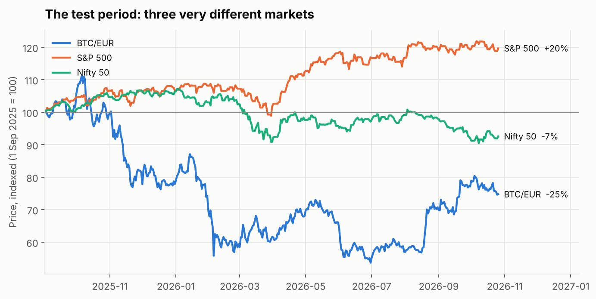

The clean window contained three very different markets: Bitcoin fell about 25% in euros, the
S&P 500 rose about 20%, and the Nifty 50 fell about 7%. A useful signal should help in all three.

---

## 5. Experiment 1: Bitcoin (BTC/EUR, 4-hour)

**Setup.** €20 start, decide every 4 hours (2,525 decisions on Colab GPU; 839 decisions every
12 hours on CPU as a cross-check), forecast 24 hours ahead. Buy when the expected move exceeds
1.5× the round-trip cost and ≥ 58% of paths end higher. Sell when the outlook turns negative.
20% drawdown breaker.

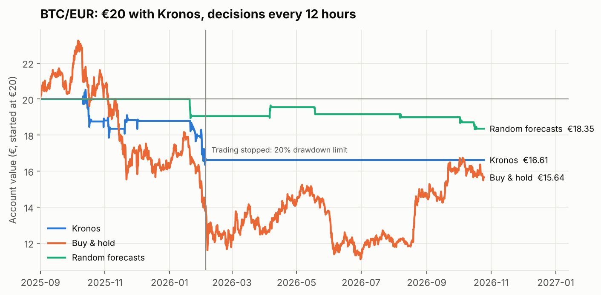

| | Kronos (4h) | Kronos (12h, CPU) | Random forecasts (4h) | Buy & hold |
|---|---|---|---|---|
| €20 became | €15.88 | €16.61 | €17.51 | €15.53 |
| Return | −20.6% | −16.9% | −12.4% | −22.3% |
| Hit rate | 49.5% | 48.6% | ~50% | — |
| Information coefficient | −0.013 | −0.008 | +0.012 | — |
| Correct when forecast > +1.5% | 44.7% (n=190) | 48.1% (n=52) | — | — |

Kronos lost slightly less than holding Bitcoin, but only because it spent most of the year in
cash while Bitcoin fell. It lost more than random forecasts did, its direction calls were a coin
flip, and the 20% drawdown breaker stopped it (in the CPU run, in February 2026).

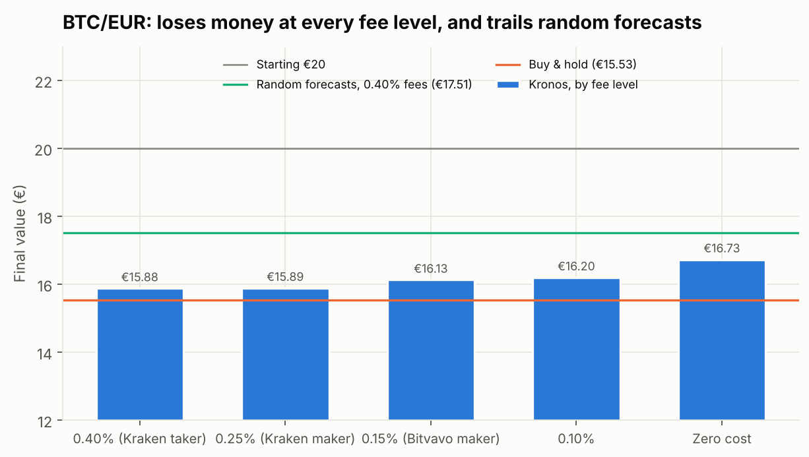

**Fees are not the cause.** Even with zero trading costs Kronos ended at €16.73, still below
random forecasts *with* full fees (€17.51). Tuning the thresholds on the first half of the year
and testing on the second half lost 5.9% while Bitcoin rose 21%.

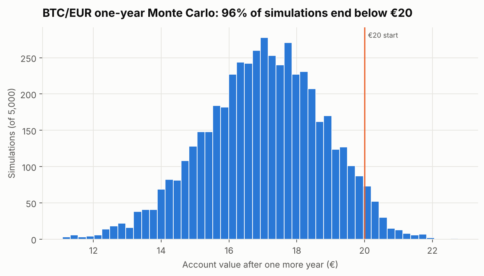

A one-year block-bootstrap Monte Carlo of the CPU run's returns (5,000 simulations, with half of
any positive drift removed as a realism haircut) ends below €20 in **96%** of cases. The median
ending value is €17.09, and 41% of paths suffer a drop of more than 20%. The Colab run gives 98%.

---

## 6. Experiment 2: S&P 500 and Nifty 50 (daily, buy-or-cash)

**Setup.** Daily candles, 400-day context, forecast 5 trading days ahead, same thresholds as
the BTC test, 0.10% fees + 5 bps slippage. Weekday trading calendar (252 trading days a year).

| Window | Kronos | Buy & hold | Random forecasts | Time invested | Hit rate | IC |
|---|---|---|---|---|---|---|
| S&P 500, Sep 2025 – Oct 2026 | +1.4% | **+19.7%** | −11.8% | 6% | 42.8% | 0.18 |
| Nifty 50, Sep 2025 – Oct 2026 | **+3.1%** | −7.6% | −6.1% | 38% | 59.5% | 0.15 |
| S&P 500, 2022 – Aug 2025* | +26.3% | **+33.8%** | −21.0% | 17% | 47.6% | 0.10 |
| Nifty 50, 2022 – Aug 2025* | +3.1% | **+39.7%** | −19.8% | 23% | 51.0% | 0.06 |

Kronos beat random forecasts in every window and had smaller drawdowns, but **holding the index
returned more in 3 of 4 windows**. It only won in the one falling market (Nifty 50, 2025–26).

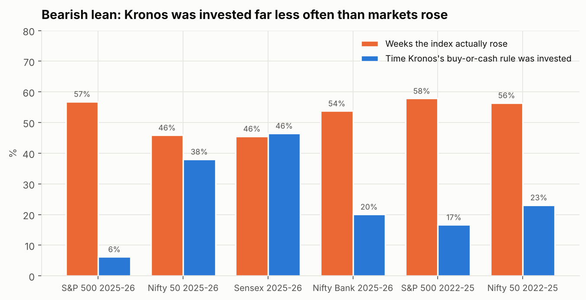

**Why it sits in cash.** The S&P 500 rose in 57% of 5-day periods during the clean window, but
the buy-or-cash rule was invested only 6% of the time. Kronos's index forecasts lean bearish
after rises, as if it expects prices to fall back toward their recent average. In a spot check
on 12 Oct 2026, it predicted a fall for the S&P 500 with 100, 200 and 400 days of history alike,
so the lean is not an artefact of one history length.

---

## 7. Forecast quality across all tests

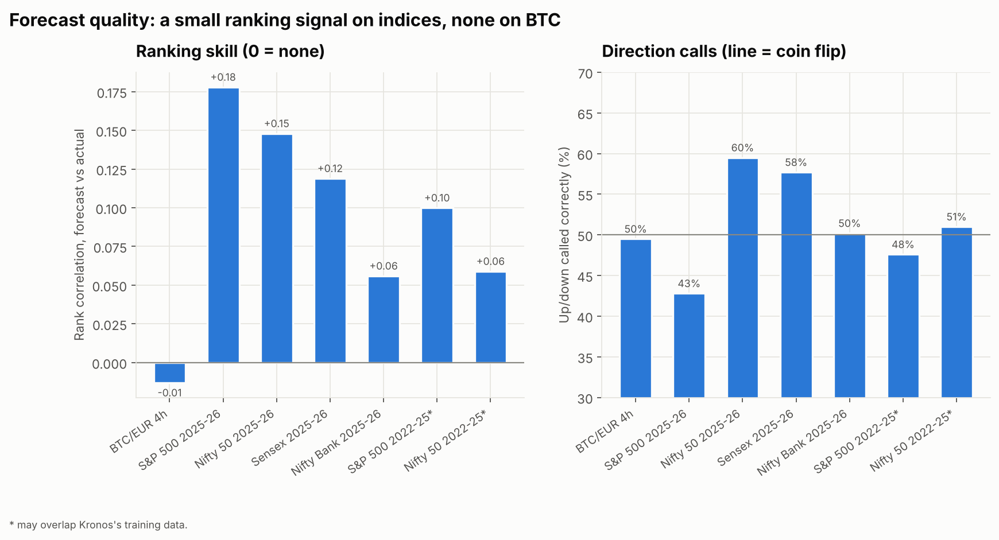

The clearest pattern of the study: **Kronos has a small but consistent ranking signal on stock
indices** (IC between +0.06 and +0.18 in every window) and **none on Bitcoin**. Up/down calls are
close to a coin flip almost everywhere, because the bearish lean drags them down in rising markets.

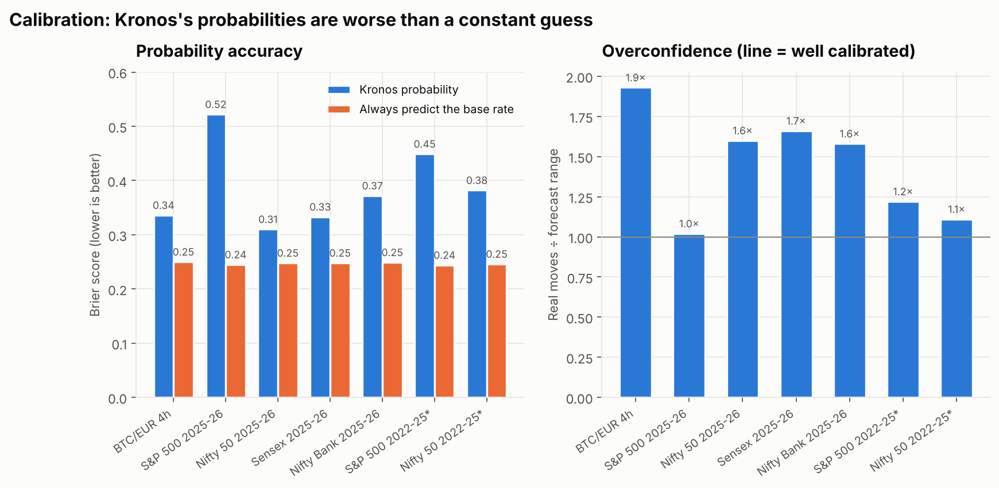

**The probabilities are not usable as-is.** In every test, Kronos's "chance of a rise" scored
worse than always predicting the historical base rate (Brier 0.31–0.52 vs about 0.25). The
forecast paths are too narrow: real moves were 1.0–1.9× wider than the forecast spread, so `p_up`
swings to 0% or 100% far more often than the outcomes justify.

---

## 8. Experiment 3: stay-invested overlay (Sensex and Nifty Bank)

**Idea.** Since Kronos leans bearish, flip the logic: stay fully invested by default and step
down to 50% only on strongly bearish forecasts (≤ 30% of paths up **and** mean forecast ≤ −1%),
returning to 100% once ≥ 45% of paths are up. Tested on two indices not used before.

**Pre-registered pass criteria (all required on each index):** (1) Sharpe ≥ buy & hold + 0.2;
(2) smaller max drawdown; (3) beats the same rule with random forecasts; (4) criterion 1 still
holds at 0.25% fees.

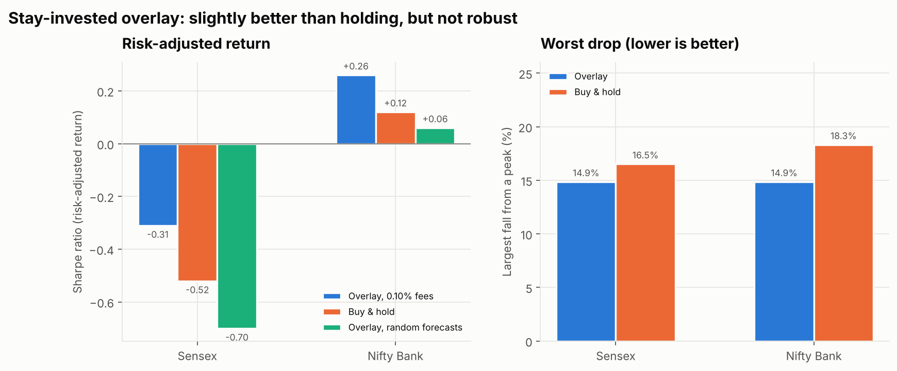

| | Sensex | Nifty Bank |
|---|---|---|
| Overlay return / buy & hold | −5.1% / −8.4% | +3.1% / +0.7% |
| Sharpe / buy & hold Sharpe | −0.31 / −0.52 | 0.26 / 0.12 |
| (1) Sharpe ≥ buy & hold + 0.2 | ✓ (+0.21) | ✗ (+0.14) |
| (2) Smaller max drawdown | ✓ (14.9% vs 16.5%) | ✓ (14.9% vs 18.3%) |
| (3) Beats random forecasts | ✓ | ✓ |
| (4) Still +0.2 at 0.25% fees | ✗ | ✗ |
| **Verdict** | **Fail** | **Fail** |

A modest improvement over holding (about 3 points of return and 2–3 points less drawdown), but
it does not survive slightly higher fees. A one-day execution delay also lowers its Sharpe on
both indices (Sensex −0.45, Nifty Bank −0.01). (Sensex moves almost exactly with the Nifty 50, with a 0.99 daily correlation,
so it adds little independent evidence.)

---

## 9. Experiment 4: weekly ranking of 12 global indices

**Idea.** Use only the signal that exists, the *ranking*, and stay invested. Each Friday, rank
12 indices (S&P 500, Nasdaq 100, Euro Stoxx 50, DAX, CAC 40, FTSE 100, Nikkei 225, Hang Seng,
Nifty 50, KOSPI, ASX 200, MSCI EM) by Kronos's forecast, hold the top K equally, and compare
with holding all 12 equally. Settings were tuned on Jan 2022 – Aug 2025 only (top 2, de-biased
forecast, 26-week de-bias window, holding buffer 4), then frozen and tested once on Sep 2025 –
Oct 2026.

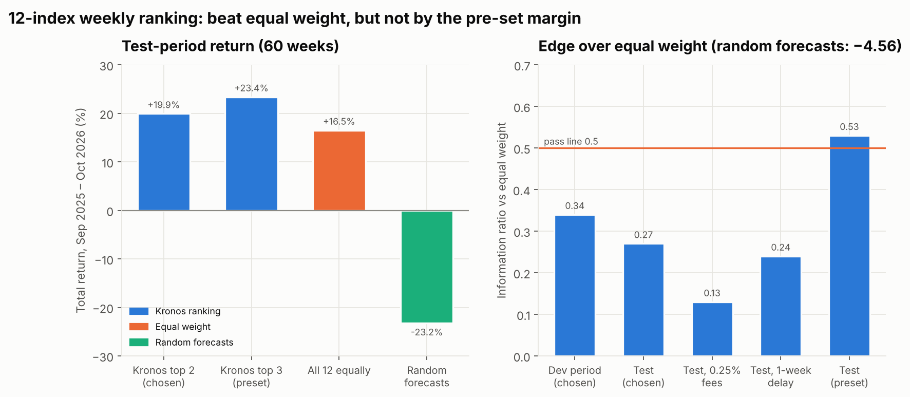

| Test window (60 weeks) | Kronos top 2 (chosen) | Kronos top 3 (preset) | Equal weight | Random forecasts |
|---|---|---|---|---|
| Total return | +19.9% | +23.4% | +16.5% | −23.2% |
| Sharpe | 1.34 | 1.55 | 1.15 | −1.37 |
| Max drawdown | −8.3% | −8.0% | −9.3% | −27.0% |
| Information ratio | **0.27** | 0.53 | — | −4.56 |
| Weekly IC (t-stat) | 0.024 (0.47) | 0.024 (0.47) | — | −0.074 |

**Verdict: Fail** (3 of 4 criteria met; the information ratio of 0.27 is below the 0.5 required).

Three reasons this is not a real edge:

- **Ranking skill is indistinguishable from zero**: weekly IC 0.024 (t = 0.47) in the test and
  0.005 (t = 0.18) during tuning.
- **Delaying every decision by a week gave the same extra return** (IR 0.24) while the IC fell to
  about zero. The gain came from which indices the low-turnover portfolio happened to hold, not
  from week-by-week forecasting.
- **The preset settings would have passed** (IR 0.53), but switching to them after seeing the
  test is exactly the selection bias pre-registration prevents. The random baseline mainly loses
  to its own trading costs, so beating it is weak evidence.

---

## 10. Experiment 5: fine-tuning Kronos on stock indices

**Setup.** The Kronos-small predictor was fine-tuned (tokenizer frozen) on daily history of the
12 indices, with training windows ending ≤ 31 Dec 2024. It was validated on forecasts landing in
Jan – Aug 2025 and tested on the Nifty 50 and S&P 500 over Sep 2025 – Oct 2026, against the
original model on the same GPU. Pass rule: higher IC **and** lower Brier on **both** indices.

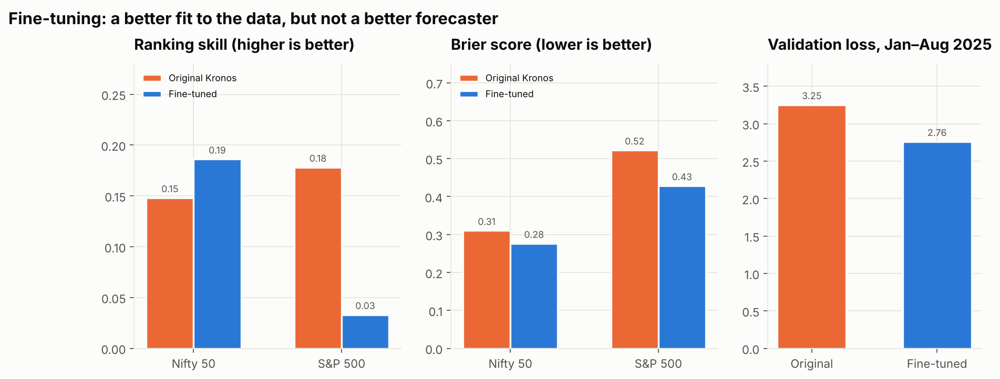

| | Nifty 50 original | Nifty 50 fine-tuned | S&P 500 original | S&P 500 fine-tuned |
|---|---|---|---|---|
| Information coefficient | 0.148 | 0.186 ↑ | 0.178 | 0.033 ↓ |
| Brier score | 0.310 | 0.276 ↓ | 0.522 | 0.428 ↓ |
| Buy-or-cash return | +3.1% | −0.1% | +1.4% | +0.1% |
| Overlay return | −4.9% | −4.5% | +11.0% | +10.2% |
| Buy & hold | −7.6% | | +19.7% | |

**Verdict: Fail.** Fine-tuning cut validation loss from 3.25 to 2.76 and improved calibration on
both indices, but ranking skill collapsed on the S&P 500 and neither strategy improved. A model
that fits candle data better is not necessarily better at predicting next week's direction. The
original model's Nifty 50 numbers reproduced the earlier run exactly, which confirms the pipeline
is deterministic.

---

## 11. Errors found and corrected during the study

Reported for transparency; all were fixed before the affected conclusions were drawn.

| Issue | Effect | Fix |
|---|---|---|
| Monte Carlo "haircut" added return to losing strategies | A losing strategy showed a +64% median | Haircut now only shrinks positive drift |
| Backtest kept running past the end of a sub-window | 2022 – 2025 index results, and the first half of each tune/test split, included Sep 2025 – Oct 2026 | Simulation stops at the last decision; regression test added; affected results re-run |
| ccxt ignored the HTTPS proxy | Market-data downloads failed | Proxy settings honoured |
| Half-precision inference (tried for speed) | Mean forecast changed from −3% to −19% | Rejected; full precision only |
| Random forecasts churned the ranking portfolio (~145% weekly turnover ≈ 11%/yr in costs) | Found before any Kronos ranking result | Holding buffer added to the design |

---

## 12. Limitations

- **One year of clean data.** The post-release window is about 14 months; daily 5-day forecasts
  give only about 57 independent weeks per index, so small effects cannot be confirmed or ruled out.
- **Not perfectly blind.** Later experiments were designed after seeing earlier ones, and some
  indices' clean-window results were already known. Pre-registration limits but does not remove this.
- **Kronos-small only.** Kronos-base (larger) and Kronos-large (not public) were not tested.
- **Local-currency index returns.** A euro investor buying ETFs would also face currency moves.
- **Simplified execution.** Fills at the next open with fixed slippage; no market-impact or
  holiday modelling beyond weekends; missing volume data on some indices.
- **Sampling settings fixed** (temperature 1.0, top-p 0.9, 16 paths). Wider sampling might fix
  calibration but not ranking skill.

---

## 13. Conclusions and recommendations

1. **Do not trade Kronos-small with real money**, zero-shot or fine-tuned, in any of the forms
   tested. No version beat its benchmark robustly after costs.
2. **Simply holding a broad index fund was the hardest benchmark to beat**: it won in most tests,
   with no model, server or maintenance.
3. **Infrastructure is not the bottleneck.** The trading, risk, monitoring and deployment layer
   works and is tested. What's missing is a predictive signal.
4. **If research continues,** the more promising directions use information Kronos does not
   see (company fundamentals, earnings, cross-asset data), or cross-sectional stock selection
   within one market with historical index membership to avoid survivorship bias. Each would need
   the same pre-registered testing before any paper trading.

---

## 14. Reproducing this report

| What | Where |
|---|---|
| Raw results (as output by the Colab notebooks) | `docs/report/results/*.json` |
| Derived series used in charts | `docs/report/data/` |
| Charts | `python docs/report/make_report_charts.py` (`--refresh` rebuilds derived data from local price files and CPU-run forecasts) |
| Pre-registrations and detailed results | `docs/BACKTEST_RESULTS.md` |
| GPU notebooks | `notebooks/kronos_backtest_colab.ipynb` (BTC), `kronos_index_backtest_colab.ipynb` (S&P 500 / Nifty 50), `kronos_india_overlay_colab.ipynb`, `kronos_rotation_colab.ipynb`, `kronos_finetune_colab.ipynb` |
| CLI | `python -m autotrader.backtest`, `autotrader.report`, `autotrader.rotation`, `autotrader.finetune`, `autotrader.montecarlo` |
| Tests | `python -m pytest tests/test_autotrader.py` (13 offline tests) |
